# User guide: from the input folders to your first launch

This guide covers both the English and Spanish editions. Choose one ZIP and use the folders and scripts belonging to that edition.

| Action or folder | English edition | Spanish edition |
| --- | --- | --- |
| Main folder | `CTR_RyuNET_Builder_EN` | `CTR_RyuNET_Constructor` |
| Diagnostics | `0_DIAGNOSTICS.cmd` | `0_DIAGNOSTICO.cmd` |
| Check input files | `1_CHECK_FILES.cmd` | `1_COMPROBAR.cmd` |
| Extract and prepare only | `2_PREPARE_FILES.cmd` | `2_PREPARAR.cmd` |
| Build the installer | `3_BUILD_PKG.cmd` | `3_GENERAR_PKG.cmd` |
| Base game | `Input/Game` | `Entrada/Juego` |
| Update | `Input/Update` | `Entrada/Actualizacion` |
| Optional DLC | `Input/DLC` | `Entrada/DLC` |
| Temporary files | `Work` | `Trabajo` |
| Completed installers | `Output` | `Salida` |
| Source code | `Source` | `Codigo` |

## 1. Extract the builder

Open [Releases](https://github.com/Trollfachender777/CTR-RyuNET-PS4/releases), select **CTR Nitro-Fueled — Builders — English and Spanish**, and expand **Assets**. Download `CTR_RyuNET_Builder_EN.zip` for English or `CTR_RyuNET_Constructor_ES.zip` for Spanish.

These screenshots show the downloaded ZIP files before extraction. Match the filename to your chosen language; the archive icon may differ depending on your ZIP application.

| English (EN) | Spanish (ES) |
| :---: | :---: |
| 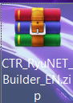 | 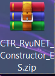 |

Right-click the ZIP, select **Extract All**, and open the extracted `CTR_RyuNET_Builder_EN` or `CTR_RyuNET_Constructor` folder. Run the scripts from that extracted folder, rather than from inside the ZIP.

### Extracted folders

After extraction, open the folder matching your edition:

| English (EN) | Spanish (ES) |
| :---: | :---: |
| 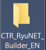 | 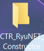 |

**What it does:** the builder needs its folders, scripts, and portable tools together. Extracting the entire archive prevents errors caused by missing files. The portable edition does not require a separate Python or compiler installation.

Allow enough space for temporary files and the installer as well as your originals. The builder checks free space at startup; with the base game, update, and DLC used during development, the check requires approximately **55 GB free**. The amount depends on your inputs.

## 2. Add the base game

Open your extracted builder folder. Double-click **Input** in the English edition or **Entrada** in the Spanish edition, highlighted in these screenshots:

| English (EN) | Spanish (ES) |
| :---: | :---: |
| 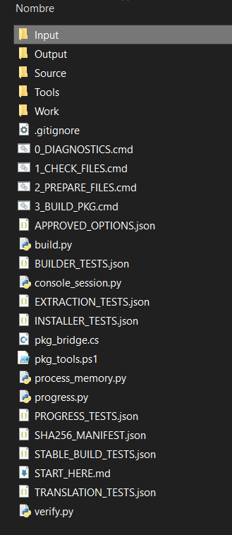 | 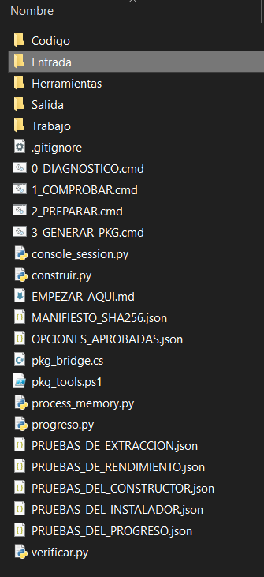 |

### Input folders

Inside **Input** (English) or **Entrada** (Spanish), you will see these three folders:

| English (EN) | Spanish (ES) |
| :---: | :---: |
| 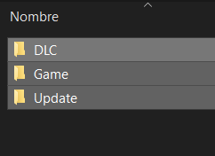 | 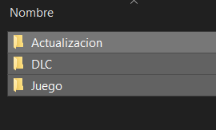 |

Double-click **Game** in English or **Juego** in Spanish. Put a single base-game PKG for **CUSA13795** there.

Use **Update / Actualizacion** for the update in [step 3](#3-add-the-update), and **DLC** for optional add-ons in [step 4](#4-add-your-dlc-if-any).

**Folder path:** `Input/Game` (English) or `Entrada/Juego` (Spanish).

**What it does:** `Input/Game` or `Entrada/Juego` holds the main game input. The builder reads its metadata to identify it. Renaming a file does not change its CUSA or make another edition compatible.

If your single PKG already contains the complete game updated to **1.21**, it can go here too. In that case, leave `Input/Update` or `Entrada/Actualizacion` empty. A PKG containing only an update cannot replace the complete game.

You can also put one folder containing the complete extracted CUSA13795 game already updated to **1.21** in **Input/Game** or **Entrada/Juego**, and leave the update folder empty. Use one input here: the PKG or the extracted folder.

## 3. Add the update

Open **Input → Update** in English or **Entrada → Actualizacion** in Spanish and add a single **1.21 update PKG for CUSA13795**, unless it is already merged into the complete game from the previous step.

**What it does:** the update supplies the executables and data expected by this integration. The builder prepares a temporary combination of the game and update while preserving the original files in your input folders.

If validation rejects the edition or executables, check your inputs. Renaming an update from another CUSA does not make it compatible.

## 4. Add your DLC, if any

Open **Input/DLC** in English or **Entrada/DLC** in Spanish and add your DLC PKGs compatible with **CUSA13795**. Leave the folder empty if you are not using DLC. Do not put the base game or update here.

**What it does:** the builder detects add-ons separately and prepares installers associated with the resulting application. DLC is optional. Its PKGs are installed after the main application; everything is not merged into one installer.

The development example includes Deluxe Pack. That does not mean every available DLC has been tested on every console.

## 5. Check the tools

Return to the main folder and open **0_DIAGNOSTICS.cmd** in English or **0_DIAGNOSTICO.cmd** in Spanish. Read the result in the window and close diagnostics when it finishes.

**What it does:** checks whether the included portable tools can run. It does not generate a PKG or modify the PS4. If it reports a missing runtime, extract the entire ZIP again before continuing.

## 6. Check your input files

Open **1_CHECK_FILES.cmd** in English or **1_COMPROBAR.cmd** in Spanish. Check that it recognizes the game, CUSA, update, and any DLC you added.

These screenshots highlight the script to open:

| English (EN) | Spanish (ES) |
| :---: | :---: |
| 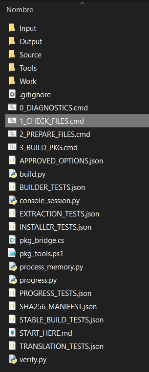 | 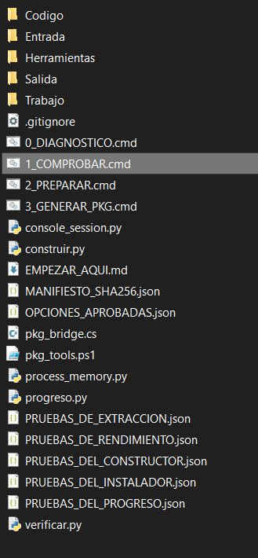 |

**What it does:** checks input placement and metadata before the lengthy build begins. It does not build the installer yet. Extraction and later checks also validate the executables required by the adaptation.

### Example check results

Compare the listed files with the game, update, and optional DLC you placed in the input folders. These examples show the base game at **01.00** and a separate update at **01.21**; that is the expected combination for this setup. Your own filenames may differ.

**English (EN)**

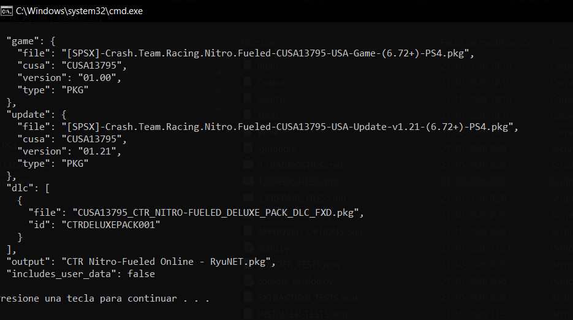

**Spanish (ES)**

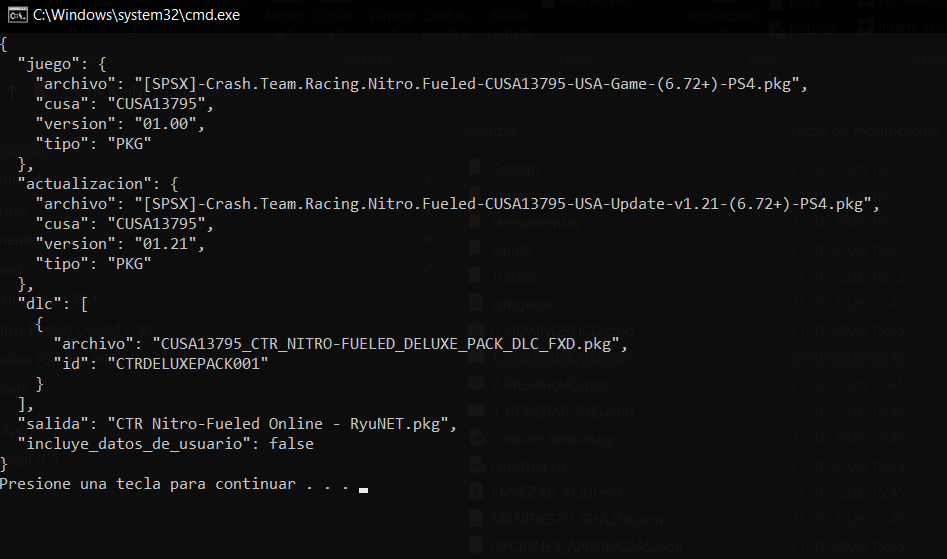

Click a screenshot to view it at full size. The **output / salida** field is the planned installer name; this check has not created that PKG yet.

When the check finishes without an error, press any key to close its window and continue to step 7.

## 7. Build the PKG

Open **3_BUILD_PKG.cmd** in English or **3_GENERAR_PKG.cmd** in Spanish. Leave the window open until it displays **Finished** or **Terminado** and the output folder. Do not run two builds at the same time.

**What it does:** extracts your inputs, prepares the data, compiles and tests the integration, builds the package, and checks the installer. It uses **Work** / **Trabajo** for temporary files and places the result in **Output** / **Salida**.

### Build in progress

These examples show **3_BUILD_PKG.cmd** (English) and **3_GENERAR_PKG.cmd** (Spanish) running while the game is being extracted:

**English (EN)**

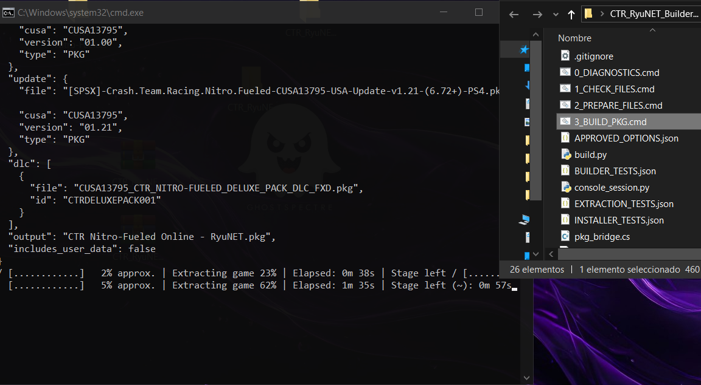

**Spanish (ES)**

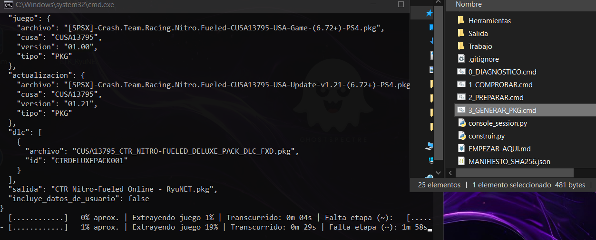

The first percentage is approximate progress for the whole build. The percentage beside **Extracting game / Extrayendo juego** applies only to that extraction stage, so the two values can differ. These screenshots show work in progress, not a completed installer. Click an image to view it at full size.

Both editions show approximate progress, the current stage, and elapsed time on the bottom line. **Stage left (~): calculating...** in English, or **Falta etapa (~): calculando...** in Spanish, means no reliable estimate is available for that stage. During **Building and testing** / **Compilando y probando**, a step counter shows the current build or test step; it may remain on the same step while that work runs.

Both editions use the same validated packaging engine and resource controls. They run at reduced Windows priority, set the processor count exposed to .NET to at most four, and prevent simultaneous builder sessions. A memory guard reclaims resident memory from the builder's own child processes above a soft threshold of 768 MiB per process. This is not a hard cap on total RAM, and temporary peaks can exceed it. No unrelated application or global Windows preference is changed.

To check what is happening, consult the **Build log** path in English (`Work/<build>/build.log`) or **Registro de compilacion** in Spanish (`Trabajo/<build>/compilacion.log`). A large output file alone does not mean the process is finished: encryption and verification may still be running.

### What is script 2 for?

**2_PREPARE_FILES.cmd** / **2_PREPARAR.cmd** is an optional way to **extract and validate files without creating a PKG**. It is not required before step 3. If you run 2 and then 3, step 3 prepares the inputs again in another work folder.

For normal use, check your inputs and run **3**. Use **2** when you only want to prepare and inspect the files.

## 8. Find the finished installer

After the builder reports **Finished** or **Terminado**, return to its main folder. Open **Output** in English or **Salida** in Spanish, highlighted below:

| English (EN) | Spanish (ES) |
| :---: | :---: |
| 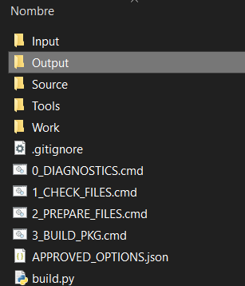 | 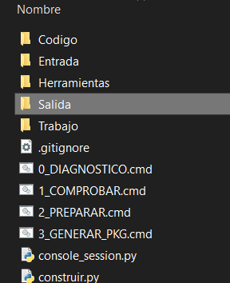 |

Open the folder for the latest completed build. It contains:

```text
CTR Nitro-Fueled Online - RyuNET.pkg
INSTALL.txt or INSTALAR.txt
DLC/                                  ← if you added DLC
```

**What it does:** the main PKG is the application you install on PS4. `INSTALL.txt` or `INSTALAR.txt` explains the installation order. The `DLC` subfolder contains installers for any add-ons you prepared.

Keep the original ZIP if you want to share a clean builder. Once used, your `Input` / `Entrada`, `Work` / `Trabajo`, and `Output` / `Salida` folders contain your own material and are not part of the clean builder.

## 9. Transfer the result to PS4 and install it

With the game closed, copy the main PKG to the installation medium you already use with your PS4. Open **Package Installer** in your GoldHEN setup and install **CTR Nitro-Fueled Online - RyuNET.pkg** first. If you generated DLC, install the PKGs from the **DLC** folder afterward.

**What it does:** installs the application before the add-ons that belong to it. The Windows builder prepares the files; installation happens on the console. Your installation medium must support a file larger than 4 GB.

Before replacing an installation you already use, back up your saves. You do not need to delete save data for another local user to have their own RyuNET identity.

## 10. Choose your RyuNET identity

Launch the application on PS4. In the setup wizard, choose a nickname of **3–16 characters** using letters, numbers, hyphens, or underscores. Save it, close the game normally, and launch it again.

**What it does:** prepares a RyuNET identity for that local user. When another local PS4 account launches the game, it can set up its own profile. You do not have to use your PSN name or someone else's nickname.

If you skip the wizard, you can play offline and set a nickname later under **L3+R3 → Online → My nickname**, or **Mi apodo** in Spanish. Personal identities and keys are stored on your console and are not shared with the builder.

## 11. Go Online and open the settings

Select **Online** from the game's menu. To open the additional settings, press **L3+R3 together** by clicking both analog sticks. See the [menu guide](MENU_L3_R3.md) for each option.

**What it does:** Online connects through RyuNET. L3+R3 opens this adaptation's settings for your nickname, contacts, and graphics. Service availability and client compatibility also affect connectivity.

## Troubleshooting

### The menu is still Spanish after installing the English edition

If you used an older test with a GoldHEN patch that loaded an external RyuNET module, close the game and check that old redirection before rebuilding another PKG. Disable only that patch and relaunch the installed application.

**Why it can happen:** the old patch can load the Spanish module from `/data/ryunet/ctr_online.prx` instead of the module included in the PKG. The custom menu's language belongs to its module; changing the system language does not translate those strings. You do not need to disable GoldHEN entirely.

### Not enough free space

Free some space or use a location with sufficient capacity, then rerun the relevant step. Preserve your original files and saves when choosing what to remove.

**Why it happens:** the input files, prepared data, and installer coexist during a build. The required space is much greater than the builder ZIP's size.

### A friend is missing or cannot be joined

Check the exact RyuNET nickname, client compatibility, and that a lobby with free slots is waiting before a race. If the list retains an old status, close and relaunch the clients to refresh the query.

**What it does:** helps distinguish an incorrect nickname, stale query, or unavailable lobby from a build failure. A test on the same network does not establish compatibility with every connection between homes or countries.
